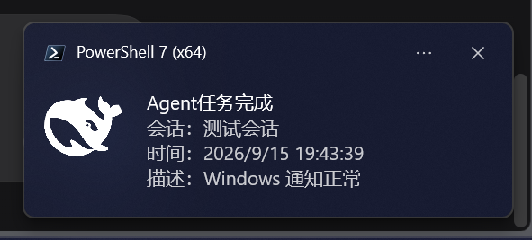

# dsh-task-notify

[中文](README.md) | [English](README.en.md)

**The moment your agent stops, Windows tells you.**

A DSH (DeepSeek Harness) Web plugin: when a main turn, subagent or workflow finishes — and whenever
the **agent pauses for you** (approval needed, a question for you, a plan awaiting review, a blocked
goal) — it raises a real **Windows system notification** (with the system sound and the DeepSeek
icon), plus optional PushPlus push to your phone, so you hear about it even with the browser closed.



*The desktop channel in the wild: title + session name / time / status, with the DeepSeek icon and the system sound.*


## Features

| Capability | What it does |
| --- | --- |
| 🔔 **System-level notifications** | Windows notifications through BurntToast (a PowerShell module), with the system sound and no web permission prompt |
| 📦 **No dependency setup** | The plugin **installs BurntToast itself** when missing (current-user scope, no admin); a machine that already has it sees no change at all |
| 🌐 **Chinese + English** | A slider in the panel header switches the notification and panel copy live; the language follows DSH's own *Settings → General → Language* and defaults to Chinese |
| 🖼️ **Hot-swappable icon** | The icon is `deepseek.png` inside the package (content-fingerprint cached): replace it and the **next notification uses the new one**, no rebuild or restart |
| 📱 **Phone push** | Optional PushPlus push, for when you are away from the machine |
| ⏸️ **Speaks up when you are the blocker** | Approvals, agent questions, plan reviews and blocked goals each get their own notification |
| 🎛️ **Saved as you click** | One master switch plus seven per-kind switches, written to DSH settings immediately and kept across restarts |
| 📐 **Layout aware** | The configuration panel tracks dsh-better-sidebar's right/bottom panels frame by frame, so it never covers them |

## What you get notified about

| Notification | Raised when |
| --- | --- |
| **Agent task finished** | A main turn / subagent / workflow ends |
| **Approval needed** | The agent lacks permission and asks for elevation (approval policy `ask`) |
| **Agent is asking you** | The agent calls `ask_user_question` and stops to consult you |
| **Plan waiting for review** | After `/plan`, the agent calls `exit_plan_mode` and waits for your decision |
| **Goal blocked** | An autonomous goal run stops on a persistent blocker |

Every notification carries the session name (walked up the parent chain to the root conversation),
the timestamp and the status (Completed / Failed / Aborted / Blocked …). The full trigger conditions,
payload format and status vocabulary are documented in [docs/notifications.md](docs/notifications.md)
(Chinese).

## Quick start

1. **Prerequisites** — Windows 10 / 11. BurntToast is **installed automatically** by the plugin
   (current-user scope, no admin). To install it by hand:

   ```powershell
   Install-Module BurntToast -Scope CurrentUser
   ```

2. **Install the plugin** — DSH ≥ 0.1.6-alpha.1; `dsh.profile.bundles` is reconciled on install:

   ```powershell
   dsh plugin --profile web add git+https://github.com/V-Reason/dsh-task-notify.git
   ```

3. **Verify** — restart DSH, click the bell in the session header → expand **Notification types** →
   **Test Windows notification**: you should hear the system sound and see a toast with the DeepSeek
   icon.

4. **Switch language** (optional) — the slider in the panel header flips between 中文 and English
   with immediate effect on both notifications and the panel. It writes DSH's own language
   preference, so it stays in sync with *Settings → General → Language*.

Phone push (optional): scan the QR code at https://www.pushplus.plus to get your one-to-one token →
expand the **Phone push** group, paste it and save → click **Test phone push**.

> Local `file:` installs, upgrades and troubleshooting: [docs/installation.md](docs/installation.md).
> Panel interactions and every setting: [docs/configuration.md](docs/configuration.md).
> If the plugin stops working after a DSH upgrade, run `npm run verify` first to tell a broken plugin
> apart from a changed platform contract — see
> [docs/troubleshooting.md](docs/troubleshooting.md) (the English docs entry point is this file).

## Documentation

The detailed documentation is written in Chinese; this file is the English entry point.

| Document | Contents |
| --- | --- |
| [安装与升级](docs/installation.md) | Requirements, git / local `file:` install, duplicate-row and build-script troubleshooting |
| [配置与使用](docs/configuration.md) | Bell and panel interactions, full settings table with defaults, PushPlus setup |
| [通知类型与触发时机](docs/notifications.md) | The seven notifications, payload composition, status vocabulary, channels, icon hot swap |
| [测试与验收](docs/testing.md) | Acceptance table, the contract verification script and recorded results |
| [DSH 升级后插件失效的排查手册](docs/troubleshooting.md) | Failure shapes, evidence sources, case studies, high-risk break points |
| [构建与开发](docs/development.md) | Directory layout, build and sync flow, implementation notes, known limits |
| [版本历史](docs/changelog.md) | Every change from 1.1.0 to 1.8.0 |

## License

Released under [MIT](LICENSE). The notification icon `deepseek.png` is derived from the DeepSeek brand
mark (`deepseek.svg`) and is used as an application icon only.
